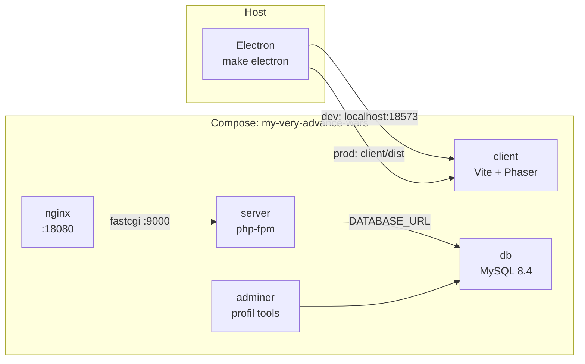

# Infrastruktura

Środowisko deweloperskie gry: Docker Compose dla klienta i backendu, oraz
osobny, hostowy proces dla Electrona. Dokumentacja odzwierciedla stan kodu
w `docker-compose.yml`, `docker/` i `electron/`.

> [!important] Ta notatka musi nadążać za kodem
> Ten dokument opisuje **faktyczny stan** infrastruktury, nie plany. Przy **każdej**
> zmianie infrastruktury zaktualizuj go w tym samym commicie:
>
> - zmiana serwisu, portu, woluminu lub zmiennej w `docker-compose.yml`,
> - edycja `docker/php/Dockerfile` lub `docker/nginx/default.conf`,
> - zmiana celów w `Makefile`,
> - zmiana pipeline'u CI (`.github/workflows/`),
> - zmiana sposobu uruchamiania Electrona (`electron/`).
>
> Zacznij od sekcji [[#Mapa sieci i portów]] i [[#Codzienna praca]] — to one
> najszybciej się dezaktualizują. Stary port/usługę popraw też w calloutach
> w [[#Rozwiązywanie problemów]].

> [!info]- Spis treści
> 1. [[#Przegląd]]
> 2. [[#Mapa sieci i portów]]
> 3. [[#Serwisy Compose]]
> 4. [[#Obrazy]]
> 5. [[#Woluminy]]
> 6. [[#Zmienne środowiskowe]]
> 7. [[#Electron (poza Compose)]]
> 8. [[#Baza map w kliencie (SQLite)]]
> 9. [[#CI (GitHub Actions)]]
> 10. [[#Codzienna praca]]
> 11. [[#Rozwiązywanie problemów]]

---

## Przegląd

Całość to **cztery serwisy Compose** (client, nginx, server, db) plus
opcjonalny adminer. Klient gry i backend startują razem, ale są od siebie
niezależne — gra na tym etapie nie łączy się z backendem.



Dwie role, dwie ścieżki:

- **Front HTTP backendu** — `nginx` (:18080) przyjmuje ruch i przekazuje do
  `server` (php-fpm) przez FastCGI.
- **Klient gry** — `client` (Vite, :18573) serwuje grę niezależnie; backendu
  używa dopiero realna logika multiplayer/sejwów.
- **Mapy z edytora** — nie przechodzą przez Compose ani MySQL. Klient trzyma je
  w SQLite (`sql.js`/WASM) w `localStorage`; szczegóły w [[Mapy]].

> [!note] Dwie bazy, dwa cele
> `db` (MySQL) należy do backendu Symfony i przyszłej rozgrywki sieciowej.
> Zapisane mapy z edytora są w bazie SQLite po stronie klienta, poza Compose.
> `Adminer` nie pokaże map z edytora.

> [!note] Dlaczego nginx osobno od php-fpm?
> PHP-FPM nie serwuje statyków ani nie obsługuje HTTP samodzielnie. Rozdzielenie
> to standard produkcyjny: nginx za frontem, php-fPM jako interpreter. W dev
> daje to ten sam układ, co na produkcji — mniej „niespodzianek" przy deployu.

---

## Mapa sieci i portów

Porty hosta są **niestandardowe** i konfigurowalne przez `.env` (patrz [[#Zmienne środowiskowe]]).
Domyślne wartości z `docker-compose.yml`:

| Serwis  | Port hosta (domyślny) | Zmienna `.env`  | Port kontenera | Do czego                                |
| ------- | --------------------- | --------------- | -------------- | --------------------------------------- |
| client  | `18573`               | `CLIENT_PORT`   | 5173           | Vite dev server (gra)                   |
| nginx   | `18080`               | `BACKEND_PORT`  | 80             | Front HTTP backendu (Symfony)           |
| db      | `127.0.0.1:13306`     | `DB_PORT`       | 3306           | MySQL — **tylko localhost**             |
| adminer | `18081`               | `ADMINER_PORT`  | 8080           | Panel do bazy (profil `tools`)          |
| server  | —                     | —               | 9000           | php-fpm — wewnątrz sieci, nieexponowany |

> [!tip] Dlaczego niestandardowe porty?
> Typowe porty (8080, 3306, 5173) są masowo skanowane przez boty. Jeśli apka
> trafi do sieci, niestandardowy port to pierwsza, najtańsza bariera — nie chroni
> sam z siebie, ale eliminuje zmasowany, ślepy ruch. Baza i tak siedzi tylko na
> loopbacku.

> [!warning] MySQL celowo tylko na `127.0.0.1`
> Port bazy jest zbindowany wyłącznie do loopbacka (`127.0.0.1:13306`), żeby nie
> wystawiać bazy na sieć. Zmiana na `13306:3306` exposures ją na zewnątrz — rób to
> świadomie.

---

## Serwisy Compose

### `client` — gra (Vite + Phaser)

Obraz `node:22-alpine`, bez własnego Dockerfile. Startuje `npm install && npm run dev`,
czyli **dev serwer Vite na żywo** z podpiętym kodem z `./client`.

- Kod montowany jako bind mount (`./client:/app`) — edytujesz na hoście, Vite
  hot-reloaduje w kontenerze.
- `node_modules` siedzi w **wymianowym woluminie** `client_node_modules`, nie na
  hoście — inaczej montowanie `./client` zasłoniłoby moduły zainstalowane w
  kontenerze (host nie ma ich w tej samej wersji/architekturze).
- Klient zawiera `sql.js` (SQLite w WebAssembly). Build emituje plik
  `dist/assets/sql-wasm-*.wasm`, a baza map jest trzymana lokalnie w
  `localStorage` przeglądarki/Electrona — nie w MySQL i bez nowego portu.
  Format i schemat opisuje [[Mapy]].

### `nginx` — front HTTP backendu

Obraz `nginx:1.27-alpine`. Serwuje `public/` z `server/` i przekazuje `.php`
do php-fpm. Konfig: `docker/nginx/default.conf` (montowany `:ro`).

### `server` — backend (php-fpm + Symfony)

Budowany z `docker/php/Dockerfile` (PHP 8.4). Nie serwuje HTTP sam — czeka na
FastCGI z nginx. Kod z `./server` (bind mount).

- `vendor/` w **wymianowym woluminie** `server_vendor` (patrz [[#Woluminy]]).
- Zmienne: `APP_ENV=dev`, `DATABASE_URL` sklejane z danych bazy.

### `db` — MySQL 8.4

Z `healthcheckiem` (`mysqladmin ping`). `server` startuje dopiero po
`condition: service_healthy` — dzięki temu Symfony nie próbuje się podłączyć do
bazy, która jeszcze się inicjalizuje.

### `adminer` — panel bazy (opcjonalny)

Pod profilem `tools`, więc **nie startuje** z zwykłym `docker compose up`.
Uruchamiasz go jawnie, gdy potrzebujesz podejrzeć dane.

---

## Obrazy

### `docker/php/Dockerfile`

Bazowy `php:8.4-fpm-alpine` (wymaganie Symfony 8.1). Trzy rzeczy dzieją się po kolei:

1. **Biblioteki uruchomieniowe** (`icu-libs`, `libzip`) — PHP linkuje do nich w
   runtime. Bez osobnego `apk add` rozszerzenia kompilują się, ale nie ładują
   (brak `.so`).
2. **Rozszerzenia** (`pdo_mysql`, `intl`, `zip`, `opcache`) kompilowane z dev-paków,
   które zaraz potem są usuwane (`--virtual .build-deps` + `apk del`) — obraz
   zostaje mniejszy.
3. **Composer** skopiowany z oficjalnego obrazu `composer:2`.

```dockerfile
FROM php:8.4-fpm-alpine
RUN apk add --no-cache icu-libs libzip
RUN apk add --no-cache --virtual .build-deps $PHPIZE_DEPS icu-dev libzip-dev \
    && docker-php-ext-install pdo_mysql intl zip opcache \
    && apk del .build-deps
COPY --from=composer:2 /usr/bin/composer /usr/bin/composer
WORKDIR /var/www/html
```

### `docker/nginx/default.conf`

Najważniejsze linie: katalog publiczny to `public/` (wejście Symfony), a ruch
`.php` idzie na `server:9000`.

```nginx
root /var/www/html/public;
location /            { try_files $uri $uri/ /index.php$is_args$args; }
location ~ \.php$     { fastcgi_pass server:9000; ... }
```

`try_files ... /index.php` to front controller pattern — wszystkie nieznane
ścieżki trafiają do Symfony, które ma własny routing.

---

## Woluminy

| Wolumin             | Montowanie                 | Po co                                                        |
| ------------------- | -------------------------- | ------------------------------------------------------------ |
| `db_data`           | `/var/lib/mysql`           | Trwałość bazy — przeżywa restarty kontenera.                 |
| `client_node_modules` | `/app/node_modules`      | Moduły Node'a poza bind mountem kodu.                        |
| `server_vendor`     | `/var/www/html/vendor`     | Zależności PHP poza bind mountem kodu.                       |

Dwa ostatnie to **wymianowe woluminy (named volumes)** osłaniające podkatalogi
kodu. Są potrzebne, bo `node_modules`/`vendor` powstają *wewnątrz* kontenera i
nie powinny mieszać się z drzewem na hoście.

> [!warning] Pierwsze uruchomienie `server_vendor` jest puste
> Wymianowy wolumin nadpisuje katalog `vendor/` z hosta. Jeśli więc `vendor`
> istnieje tylko na hoście (a nie w woluminie), backend odpali się bez autoloada
> i skończy na `Failed to open stream: .../autoload_runtime.php`.
>
> **Objaw:** `500` zamiast JSON-a z `GET /`.
> **Fix:** `docker compose exec server composer install` (wypełnia wolumin).
> Szczegóły w [[#Rozwiązywanie problemów]].

---

## Zmienne środowiskowe

Compose czyta plik `.env` w katalogu głównym. Wartości domyślane działają bez
niego, więc plik jest opcjonalny na start.

| Zmienna              | Domyślna                  | Uwagi                                  |
| -------------------- | ------------------------- | -------------------------------------- |
| `MYSQL_ROOT_PASSWORD`| `root`                    | Tylko dev. Zmień w `.env.local`.       |
| `MYSQL_DATABASE`     | `my_very_advance_wars`    |                                        |
| `MYSQL_USER`         | `app`                     |                                        |
| `MYSQL_PASSWORD`     | `app`                     | Tylko dev. Zmień w `.env.local`.       |
| `CLIENT_PORT`        | `18573`                   | Port Vite dev servera na hoście.       |
| `BACKEND_PORT`       | `18080`                   | Port nginx (front backendu).           |
| `DB_PORT`           | `13306`                   | Port MySQL — bind do `127.0.0.1`.      |
| `ADMINER_PORT`      | `18081`                   | Port Adminera (profil `tools`).        |

> [!tip]
> Skopiuj `.env.example` na `.env` i dopisz własne hasła. Plik `.env` jest
> w `.gitignore` — **nie trafia do repo**. Plik `.env` Symfony (`server/.env`,
> z `APP_SECRET`) też jest ignorowany.

---

## Electron (poza Compose)

Electron **celowo nie ma serwisu w Compose** i nie powinien mieć:

- okno gry wymaga ekranu — kontener nie ma displaya (trzeba by X11/vfb),
- build pod Windows/macOS/Linux wymaga narzędzi z systemu docelowego,
- Electron tylko opakowuje gotowy build klienta (`client/dist`).

Dlatego uruchamiasz i budujesz go **na hoście**:

```bash
make electron        # dev: ładuje Vite z kontenera (localhost:18573)
make run             # alias make electron
make electron-build  # buduje client/dist i paczkę do electron/release
```

Albo równoważnie przez npm bezpośrednio:

```bash
cd client && npm run build      # produkuje client/dist
npm start --prefix electron     # dev: ładuje localhost:18573
npm run build --prefix electron # buduje paczkę do electron/release
```

Pliki: `electron/main.cjs` (okno — pełne ekran, bez menu, F11/Alt+Enter
przełącza fullscreen) i `electron/preload.cjs` (contextIsolation + sandbox).

W trybie dev Electron ładuje Vite z kontenera pod `http://localhost:18573`.
To adres domyślny — `make electron` **nie przekazuje** `CLIENT_PORT` z `.env`
do Electrona. Po zmianie portu uruchom jawnie:

```bash
VITE_DEV_SERVER_URL=http://localhost:19000 make electron
```

W buildzie produkcyjnym `main.cjs` ładuje statyczny
`client/dist/index.html`.

> [!warning] Paczka Electrona to nadal szkielet
> `make electron-build` buduje `client/dist`, ale `electron/package.json` w
> `files` pakuje wyłącznie `main.cjs` i `preload.cjs`. Katalog `client/dist`
> **nie trafia** do `resources/`, więc uruchomienie paczki z
> `electron/release/` nie znajdzie `index.html`. To nie wpływa na
> `make electron` (dev), ale do testu produkcyjnego trzeba dodać `client/dist`
> przez `extraResources` albo rozszerzyć `files`.

DevTools Electrona nie otwierają się same — włączasz je zmienną
`ELECTRON_DEVTOOLS=1` (`ELECTRON_DEVTOOLS=1 make electron`).

---

## Baza map w kliencie (SQLite)

Mapy z edytora są zapisywane w SQLite uruchomionym w kliencie przez `sql.js`
(WASM). Nie ma tu kontenera, portu ani wolumenu Compose — baza żyje w profilu
przeglądarki/Electrona.

| Element | Gdzie |
| ------- | ----- |
| Baza | `localStorage['mvaw:sqlite']` (base64 pliku SQLite) |
| Silnik | `sql.js` + `sql-wasm.wasm` (build: `client/dist/assets/sql-wasm-*.wasm`) |
| Kod | `client/src/storage/database.ts`, `maps.ts`, `mapSerialization.ts` |
| Format | `GameState` jako JSON w kolumnie `maps.state` |
| Profil Electrona (Linux) | `~/.config/@my-very-advance-wars/electron` |
| Origin dev | `http://localhost:18573` |
| MySQL/Adminer | **nie zawierają** map z edytora |

`localStorage` jest przypisany do originu i profilu. Zmiana portu, hosta
(`localhost` → `127.0.0.1`) albo uruchomienie packaged `file://` powoduje, że
aplikacja czyta inny magazyn i pokazuje pustą listę — mimo że stara baza nadal
istnieje. `make clean` również jej nie usuwa, bo nie jest wolumenem Compose.
Pełny opis schematu, formatu JSON, limitów i diagnostyki: [[Mapy]].

---

## CI (GitHub Actions)

Pipeline `.github/workflows/ci.yml` sprawdza typy klienta. Uruchamia się przy
pushu na `master`, przy każdym pull requeście i ręcznie (`workflow_dispatch`).

- **Zakres:** `tsc --noEmit` w `client/` — ten sam check co `make lint`. Testy
  Vitest nie są częścią pipeline'u.
- **Środowisko:** `ubuntu-latest`, Node 22 (jak obraz `node:22-alpine` w Compose).
- **Kroki:** checkout, `npm ci` z cache opartym na `client/package-lock.json`,
  `npx tsc --noEmit`.
- **Uprawnienia:** tylko odczyt repozytorium (`contents: read`).

Pipeline nie buduje aplikacji ani nie uruchamia Dockera — sprawdza wyłącznie
typy, więc trwa krótko i nie wymaga sekretów.

---

## Codzienna praca

Wygodnym frontem jest `Makefile` w katalogu głównym (`make help` pokazuje listę).
Compose bezpośrednio też działa — poniżej oba warianty.

| Co                                       | `make`                | Bezpośrednio (compose)                                    |
| ---------------------------------------- | --------------------- | --------------------------------------------------------- |
| Lista celi                               | `make help`           | —                                                         |
| Start wszystkiego                        | `make up`             | `docker compose up -d`                                    |
| Start z adminerem                        | `make up-tools`       | `docker compose --profile tools up -d`                    |
| Status                                   | `make ps`             | `docker compose ps`                                       |
| Logi (wszystko)                          | `make logs`           | `docker compose logs -f`                                  |
| Logi backendu                            | `make logs-server`    | `docker compose logs -f server`                           |
| Shell w backendzie                       | `make shell`          | `docker compose exec server sh`                           |
| Konsola Symfony                          | `make console about`  | `docker compose exec server php bin/console about`        |
| Zainstaluj zależności PHP                | `make composer`       | `docker compose exec server composer install`             |
| Wyczyść cache Symfony                    | `make cache-clear`    | `docker compose exec server php bin/console cache:clear`  |
| MySQL CLI                                | `make db-shell`       | —                                                         |
| Rebuild backendu (po Dockerfile)         | `make rebuild`        | `docker compose build --no-cache && docker compose up -d` |
| Uruchom Electrona (dev)                  | `make electron`       | `npm start --prefix electron`                             |
| Uruchom Electrona (alias)                | `make run`            | `npm start --prefix electron`                             |
| Build klienta + Electrona                | `make electron-build` | —                                                         |
| Przebuduj klienta (po zmianach)           | —                     | `cd client && npm run build && docker compose restart client` |
| Testy klienta (Vitest)                   | `make test`           | `cd client && npm test`                                   |
| Typy klienta                             | `make lint`           | `cd client && npx tsc --noEmit`                           |
| Typy klienta w CI                        | —                     | GitHub Actions: `.github/workflows/ci.yml` (push, PR)     |
| Zatrzymaj wszystko                       | `make down`           | `docker compose down`                                     |
| Zatrzymaj i usuń woluminy (⚠️ MySQL)      | `make clean`          | `docker compose down -v`                                  |

> [!tip] `make console` przyjmuje argumenty
> `make console about`, `make console debug:router` itd. — argumenty po nazwie
> celu trafiają do `bin/console`.

---

## Rozwiązywanie problemów

> [!question]- `GET http://localhost:18080/` zwraca 500 o brakującym `autoload_runtime.php`
> **Przyczyna:** wymianowy wolumin `server_vendor` nadpisał katalog `vendor/`,
> więc w kontenerze nie ma autoloadera.
>
> **Rozwiązanie:**
> ```bash
> make composer
> ```
> Następnie wyczyść cache, jeśli trzeba:
> ```bash
> make cache-clear
> ```

> [!question]- Backend startuje, ale `GET /` pokazuje stronę „Welcome to Symfony" (404)
> **Przyczyna:** routing nie rejestruje Twojego kontrolera.
>
> W Symfony 8.1 tag `routing.controller` jest dodawany przez autokonfigurację
> atrybutu **`Symfony\Component\Routing\Attribute\Route`**. Jeśli w kontrolerze
> importujesz `Symfony\Component\HttpKernel\Attribute\Route` (klasę nadrzędną),
> tag nie zostaje dodany i trasa nie istnieje.
>
> **Rozwiązanie:** użyj importu `Symfony\Component\Routing\Attribute\Route`.
> Sprawdź trasę: `make console debug:router`.

> [!question]- Kontener `server` crashuje przy starcie / `db` w kółko „unhealthy"
> **Sprawdź logi:** `make logs db server`.
>
> `server` czeka na zdrową bazę (`depends_on: condition: service_healthy`). Jeśli
> baza długo się inicjalizuje (pierwszy start, wolny dysk), healthcheck może nie
> zdążyć — poczekaj lub zwiększ `start_period` w `docker-compose.yml`.

> [!question]- Aplikacja się nie ładuje po przeniesieniu modułu (np. plik zamieniony na katalog)
> Vite trzyma w pamięci rozwiązanie importów. Gdy `src/core/map.ts` zmienisz w
> katalog `src/core/map/`, stary import wskazuje już nieistniejący plik i Vite
> zwraca `Failed to load url /src/core/map.ts` — aplikacja nie startuje, choć
> kod w repozytorium jest poprawny.
>
> **Rozwiązanie:** zrestartuj klienta, żeby Vite rozwiązał importy od nowa:
> ```bash
> docker compose restart client
> ```
> Ten sam objaw daje pusty ekran po `npm install` w kontenerze — wtedy
> `docker compose restart client` też wystarczy.

> [!question]- Zmiana w `docker-compose.yml` lub Dockerfile nie bierze się pod uwagę
> Compose nie przebudowuje obrazu przy zwykłym `up`. Przy zmianie
> **Dockerfile** lub sekcji `build:`:
> ```bash
> make rebuild
> ```
> Przy zmianie samej konfiguracji (porty, zmienne) wystarczy `make up`.

> [!question]- Port zajęty (`port is already allocated`)
> Coś innego trzyma port (stary kontener, inna aplikacja). Sprawdź:
> ```bash
> make ps
> docker ps --filter "publish=18080"
> ```
> Albo zatrzymaj stare kontenery: `make down` i podnieś ponownie (`make up`).
> Inny port ustawisz w `.env` (zmienna `BACKEND_PORT`).

> [!question]- Po restarcie Electrona nie ma zapisanej mapy
> Najczęstsze przyczyny:
> 1. mapa nie została zapisana przyciskiem `ZAPISZ` — samo `ESC` odkłada tylko
>    szkic sesji (`registry`),
> 2. uruchomiono inny origin (np. po zmianie `CLIENT_PORT` lub
>    `VITE_DEV_SERVER_URL`),
> 3. uruchomiono inny profil Electrona albo przeglądarkę zamiast Electrona,
> 4. uruchomiono packaged `file://` zamiast dev `http://localhost:18573`.
>
> Sprawdź w DevTools: `location.origin` i
> `localStorage.getItem('mvaw:sqlite')?.length`. Więcej: [[Mapy#Diagnostyka i kopie zapasowe]].
> Zapisana wersja mapy wbudowanej jest scalona z jej kafelkiem i ma dopisek
> „zapisana” — nie jest osobnym wpisem w sekcji zapisanych map.

> [!question]- `make clean` usunął mapy?
> Nie. `make clean` usuwa woluminy Compose (`db_data`, `client_node_modules`,
> `server_vendor`), a mapa z edytora jest w `localStorage` profilu
> Electrona/przeglądarki. Mapy giną dopiero po wyczyszczeniu danych profilu
> albo `localStorage.removeItem('mvaw:sqlite')`.

> [!question]- Paczka Electrona nie startuje: `ERR_FILE_NOT_FOUND`
> Obecny `electron-build` jest szkieletem: `files` w `electron/package.json`
> pakuje tylko `main.cjs` i `preload.cjs`, bez `client/dist`. Do testu
> produkcyjnego dodaj `client/dist` przez `extraResources` albo używaj
> `make electron` (dev).

> [!question]- Czy mapy są w MySQL/Adminerze?
> Nie. `db` i `Adminer` dotyczą backendu Symfony. Mapy z edytora są w SQLite
> w `localStorage` klienta — patrz [[Mapy#Schemat bazy]].

---

> [!success] Powiązane
> - [[Mapy]] — model mapy, schemat SQLite, trwałość i diagnostyka zapisanych map.
> - [[ADR]] — ADR-001: decyzja o stacku (TypeScript + Phaser + Electron, backend Symfony).
> - [[Zadania]] — INFRA-001 (środowisko Docker), BACKEND-001 (szkielet Symfony), DESKTOP-001 (Electron).
