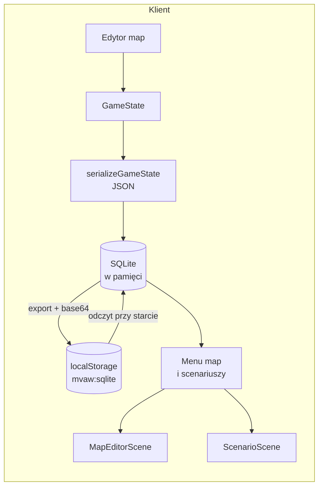

# Mapy i baza SQLite

> [!info] Co opisuje ta notatka
> Model mapy, format zapisu, schemat tabeli `maps`, migracje i seed, trwałość
> danych w przeglądarce i Electronie oraz sposoby diagnostyki. Infrastruktura
> uruchomieniowa jest w [[Infrastruktura]], a decyzja o wyborze SQLite —
> w [[ADR#ADR-017: Wewnętrzna baza map w SQLite (sql.js)|ADR-017]].

> [!warning] To nie jest baza MySQL z backendu
> Mapy z edytora **nie trafiają do MySQL** ani do wolumenu `db_data`. MySQL
> obsługuje przyszły backend Symfony, a mapy są trzymane w kliencie: SQLite
> uruchomiony przez `sql.js` (WebAssembly) i zapisany w `localStorage` pod
> kluczem `mvaw:sqlite`.

> [!info]- Spis treści
> 1. [[#Przegląd]]
> 2. [[#Model mapy]]
> 3. [[#Schemat bazy]]
> 4. [[#Format stanu gry]]
> 5. [[#Migracje i seed]]
> 6. [[#Zapis i odczyt]]
> 7. [[#Trwałość i lokalizacja danych]]
> 8. [[#Identyfikatory i mapy wbudowane]]
> 9. [[#Limity i zachowanie awaryjne]]
> 10. [[#Diagnostyka i kopie zapasowe]]
> 11. [[#Testy i pliki]]
> 12. [[#Rozwiązywanie problemów]]

---

## Przegląd

Mapy dzielą się na dwie grupy:

- **wbudowane** — generowane w kodzie (`client/src/core/map/catalog.ts`) i
  dodatkowo seedowane do bazy przy pierwszej migracji; kod jest fallbackiem,
  gdy wpisu w bazie nie ma,
- **zapisane** — tworzone lub modyfikowane w edytorze i zapisywane przyciskiem
  `ZAPISZ` do lokalnej bazy SQLite.

Baza jest **lokalna dla profilu i originu**. Nie ma synchronizacji między
urządzeniami, przeglądarkami ani profilami Electrona. To świadoma decyzja z
ADR-017 — gra ma działać bez backendu.

> [!important] Mapy wbudowane są seedowane, ale nie nadpisują zapisów
> `dolina` i `wzgorza` są generowane w kodzie (`client/src/core/map/catalog.ts`)
> i migracja `003-seed-maps` wstawia ich stan startowy do SQLite. Wpis ma
> `source = builtin` i nie jest oznaczany w menu jako „zapisana”. Jeżeli wpis
> już istnieje (np. użytkownik zapisał swoją wersję), migracja go nie rusza.
> Zapis z edytora zmienia `source` na `editor`; usunięcie wiersza przywraca
> wersję z kodu.



Przepływ zapisu:

1. `MapEditorScene` składa `GameState` (mapa + jednostki + licznik).
2. `saveMap()` woła `openDatabase()`, które uruchamia migracje (`runMigrations()`).
3. `upsertMap()` robi `INSERT ... ON CONFLICT(id) DO UPDATE`, więc kolejny zapis
   tego samego `id` aktualizuje wpis zamiast go dublować; zapis użytkownika
   ustawia `source = editor`.
4. `persistDatabase()` eksportuje całą bazę przez `db.export()`, koduje do
   base64 i zapisuje w `localStorage`.
5. Menu map i menu scenariuszy odczytują wpisy przez `listSavedMaps()` oraz
   `loadSavedMap()`.

---

## Model mapy

Mapa jest zbiorem heksów o **absolutnych współrzędnych**, a nie prostokątną
tablicą o stałym rozmiarze. Dzięki temu można malować poza pierwotnym obszarem,
a mapa rośnie w każdą stronę bez przesuwania istniejących kafli.

```ts
interface GameMap {
  readonly cells: Readonly<Record<string, TerrainId>>;
}

interface GameState {
  readonly map: GameMap;
  readonly units: readonly Unit[];
  readonly nextUnitSeq: number;
}
```

Stan tury (`TurnState` z `client/src/core/turn.ts`) nie jest częścią `GameState`.
`GameState` opisuje zapisywalną mapę i jednostki, a tura jest stanem sesji
scenariusza — dzięki temu format JSON i schemat SQLite nie muszą się zmieniać
przy każdej zmianie zasad tur (ADR-020).

- Klucz komórki to `"col,row"`, np. `"12,3"`.
- `col` i `row` są liczbami całkowitymi w układzie **offset odd-r**; wartości
  mogą być ujemne, bo mapa może rosnąć też w lewo i w górę.
- Numeracja w HUD edytora jest **podwojona** (`2 * col + (row & 1)`) — szczegóły
  w [[ADR#ADR-004: Siatka heksagonalna|ADR-004]].
- Brak wpisu w `cells` oznacza brak kafla (czarne tło), a nie domyślną łąkę.

### Tereny

| `TerrainId` | Etykieta | Koszt ruchu | Obrona |
| ----------- | -------- | ----------: | -----: |
| `plain`     | Łąka     |           1 |      0 |
| `forest`    | Las      |           2 |     20 |
| `water`     | Woda     |  nieprzech. |      0 |
| `mountain`  | Góry     |           3 |     30 |
| `swamp`     | Bagno    |           2 |     10 |
| `road`      | Droga    |         0.5 |      0 |
| `city`      | Miasto   |           1 |     40 |

Źródło: `client/src/core/terrain.ts`. Lista `TERRAIN_IDS` jest jednocześnie
listą dozwolonych wartości przy odczycie z bazy — nowy teren trzeba dodać
również tam.

### Jednostki

Jednostka ma `id`, `kind`, `faction`, `pos`, `hp`, `movesLeft` i `hasActed`.
Czołg i artyleria mają dodatkowo `ammo`; piechota i zwiad nie mają pola amunicji.

| `UnitKind` | Etykieta  | Max HP | Ruch | Amunicja w zapisie |
| ---------- | --------- | -----: | ---: | ------------------ |
| `infantry` | Piechota  |     10 |    4 | —                  |
| `tank`     | Czołg     |     20 |    3 | wymagana           |
| `artillery`| Artyleria |     14 |    2 | wymagana           |
| `scout`    | Zwiad     |      8 |    6 | —                  |

Strony: `blue`, `red`, `neutral`. W edytorze dostępne są niebieska i czerwona;
`neutral` jest obsługiwana przez model i walidację.

---

## Schemat bazy

Schemat tworzą migracje w `client/src/storage/migrations/`:
`001-initial.ts` zakłada tabelę, a `002-map-source.ts` dodaje `source`.
Pełny stan po migracjach:

```sql
CREATE TABLE maps (
  id          TEXT PRIMARY KEY,
  name        TEXT NOT NULL,
  description TEXT NOT NULL DEFAULT '',
  state       TEXT NOT NULL,
  tiles       INTEGER NOT NULL,
  units       INTEGER NOT NULL,
  created_at  TEXT NOT NULL,
  updated_at  TEXT NOT NULL,
  source      TEXT NOT NULL DEFAULT 'editor'
);
```

| Kolumna       | Znaczenie |
| ------------- | --------- |
| `id`          | Klucz mapy. Wbudowane: `dolina`, `wzgorza`; nowe: `local-<base36>` z `Date.now()`. |
| `name`        | Nazwa widoczna w menu. |
| `description` | Opis; zapis z edytora używa domyślnie „Mapa zapisana w edytorze”. |
| `state`       | Cały `GameState` jako JSON (patrz [[#Format stanu gry]]). |
| `tiles`       | Liczba kafli w `state.map.cells`; liczona przy zapisie. |
| `units`       | Liczba jednostek w `state.units`; liczona przy zapisie. |
| `created_at`  | Data pierwszego zapisu, ISO 8601 UTC. |
| `updated_at`  | Data ostatniego zapisu, ISO 8601 UTC; aktualizowana przy upsercie. |
| `source`      | `builtin` dla wpisu z seeda, `editor` dla zapisu użytkownika. |

`created_at` nie jest nadpisywane przy kolejnym zapisie tego samego `id`.
`updated_at` jest ustawiane przez `upsertMap()` na czas bieżący. Zapis z edytora
zmienia `source` na `editor`, więc seedowana mapa wbudowana staje się zwykłą
zapisaną mapą.

Przykładowy wiersz (`state` skrócony):

```text
id         = local-mvky46yh
name       = Moja mapa
description= Mapa zapisana w edytorze
tiles      = 48
units      = 1
source     = editor
created_at = 2026-10-23T12:28:08.666Z
updated_at = 2026-10-23T12:28:08.666Z
state      = {"map":{"cells":{"0,0":"plain","1,0":"forest"}},"units":[...],"nextUnitSeq":2}
```

---

## Format stanu gry

`state` to wynik `serializeGameState()` z
`client/src/storage/mapSerialization.ts`:

```json
{
  "map": {
    "cells": {
      "0,0": "plain",
      "1,0": "forest",
      "2,0": "water"
    }
  },
  "units": [
    {
      "id": "u1",
      "kind": "tank",
      "faction": "blue",
      "pos": { "col": 1, "row": 0 },
      "hp": 20,
      "movesLeft": 3,
      "hasActed": false,
      "ammo": 6
    }
  ],
  "nextUnitSeq": 2
}
```

Przy odczycie `deserializeGameState()` odrzuca:

- tekst, który nie jest poprawnym JSON-em,
- brak `map`, `map.cells`, `units` albo `nextUnitSeq`,
- klucz komórki niezgodny z `^-?\d+,-?\d+$`,
- nieznany `TerrainId`,
- jednostkę bez `id`, z nieznanym `kind`/`faction`, bez poprawnej pozycji,
- jednostkę bez poprawnych `hp`, `movesLeft`, `hasActed`,
- czołg lub artylerię bez poprawnej `ammo`.

Dzięki temu uszkodzony wpis nie wywraca całego menu — odczyt pojedynczej mapy
kończy się błędem, a reszta listy może się pokazać.

---

## Migracje i seed

### Runner

`client/src/storage/migrations.ts` prowadzi wersjonowanie schematu:

1. tworzy tabelę `schema_migrations` (`version`, `name`, `applied_at`),
2. odczytuje zastosowane wersje,
3. wykonuje brakujące migracje po kolei, każdą w transakcji,
4. zapisuje wersję dopiero po udanym `up()`,
5. przy błędzie robi `ROLLBACK` i przerywa otwarcie bazy.

Migracje są idempotentne: ponowne otwarcie bazy nie powtarza już zapisanych
wersji. Kolejność i unikalność wersji pilnuje test
`tests/storage/migrations.test.ts`.

### Wersje

| Wersja | Plik | Co robi |
| -----: | ---- | ------- |
| 1 | `001-initial.ts` | Tworzy tabelę `maps` i jej podstawowe kolumny. |
| 2 | `002-map-source.ts` | Dodaje `source` z wartością domyślną `editor`; sprawdza `PRAGMA table_info`, więc działa też na bazie ze starego schematu. |
| 3 | `003-seed-maps.ts` | Wstawia mapy z pliku seed przez `ON CONFLICT(id) DO NOTHING`. |

> [!note] Brak rollbacku i CLI
> Runner jest celowo minimalny: nie ma `down()`, komendy `make migrate` ani
> wywołania z PHP. Migracje uruchamiają się w kliencie przy otwarciu bazy.
> Doctrine Migrations z backendu nie mają tu zastosowania, bo baza żyje
> w profilu przeglądarki/Electrona, a nie w MySQL.

### Plik seed

Dane startowe leżą w `client/src/storage/seed/maps.json`:

```json
{
  "version": 1,
  "maps": [
    {
      "id": "dolina",
      "name": "Dolina",
      "description": "Rzeka przez łąki, lasy i jedno miasto.",
      "source": "builtin",
      "createdAt": "2026-10-23T00:00:00.000Z",
      "updatedAt": "2026-10-23T00:00:00.000Z",
      "state": {
        "map": { "cells": { "0,0": "plain" } },
        "units": [],
        "nextUnitSeq": 1
      }
    }
  ]
}
```

Zasady:

- `state` jest walidowany przez `deserializeGameState()`; nie można wstawić
  nieznanego terenu ani niepoprawnej jednostki,
- `source` w seedzie powinien być `builtin`; zapis z edytora i tak ustawi
  `editor`,
- migracja nie nadpisuje istniejącego `id` — dzięki temu zapisana wersja mapy
  wbudowanej i mapy użytkownika są bezpieczne,
- aby dodać mapę startową, dopisz ją do `maps` i dodaj nową migrację (np.
  `004-seed-maps-v2.ts`) albo wyczyść bazę przed ponownym uruchomieniem;
  sama zmiana JSON-a nie uruchomi już zastosowanej wersji 3.

Aktualny seed zawiera `dolina` i `wzgorza`. Kod w `core/map/catalog.ts` nadal
jest źródłem tych map, gdy w bazie nie ma ich wierszy.

---

## Zapis i odczyt

### Zapis z edytora

- `ZAPISZ` w `MapEditorScene` woła `saveCurrentMap()`.
- Nowa mapa dostaje `local-<base36>`; mapa wbudowana zachowuje swoje `id`
  (`dolina`/`wzgorza`), więc zapis nadpisuje jej zapisaną wersję.
- Zapis ustawia `source = editor`; dzięki temu seedowana mapa wbudowana staje
  się zwykłą mapą użytkownika i może pojawić się w menu scenariuszy.
- Po udanym zapisie przycisk pokazuje `ZAPISANO`; przy błędzie `BŁĄD ZAPISU`.
- Samo wyjście `ESC` **nie zapisuje do bazy**. Dla mapy, która ma już
  `mapId` (wbudowana albo wcześniej zapisana), `leaveTo()` odkłada szkic w
  `registry` na czas sesji; wraca on po powrocie z menu map, ale ginie po
  restarcie aplikacji. Nowa, jeszcze niezapisana mapa nie ma `mapId`, więc
  wyjście nie zachowuje nawet szkicu sesji.
- Zapis dotyczy całego `GameState`: terenu, jednostek i `nextUnitSeq`.

### Odczyt w menu

- Menu map pokazuje „Nowa mapa”, mapy wbudowane i sekcję
  „ZAPISANE MAPY (SQLite)”.
- Wpis `source = builtin` jest **scalany z kafelkiem mapy wbudowanej** i nie
  dostaje dopisku „zapisana”; otwiera stan z seeda, a gdy wpisu nie ma — stan
  z kodu.
- Zapisana wersja mapy wbudowanej (`source = editor`) jest scalana z kafelkiem
  mapy wbudowanej i ma dopisek „zapisana”. Dzięki temu kliknięcie „Wzgórza” po
  restarcie nie otwiera po cichu pierwotnej wersji.
- Szkic z bieżącej sesji ma pierwszeństwo przed stanem z bazy i jest oznaczony
  dopiskiem „szkic”.
- Menu scenariuszy pokazuje wyłącznie mapy ze `source = editor`; seedowane mapy
  wbudowane nie są tam duplikowane.

### Cykl życia bazy

`openDatabase()` trzyma jedną współdzieloną obietnicę (`databasePromise`) na
czas życia strony. Pierwsze otwarcie:

1. ładuje `sql.js` i WASM,
2. czyta `localStorage['mvaw:sqlite']`,
3. dekoduje base64 do `Uint8Array`,
4. tworzy `new SQL.Database(bytes)`,
5. uruchamia `runMigrations()` — tworzy `schema_migrations`, wykonuje brakujące
   migracje i seed, a jeśli coś zastosowano, od razu zapisuje bazę do
   `localStorage`.

Jeżeli zapisany bajtowo plik jest uszkodzony, `createDatabase()` usuwa klucz z
`localStorage` i tworzy pustą bazę. Oznacza to **utratę poprzednich map** — nie
ma automatycznego backupu. Migracje chronią schemat przed zmianami, ale nie
ratują uszkodzonego pliku.

---

## Trwałość i lokalizacja danych

`localStorage` jest przypisany do **originu** (schemat + host + port), a w
Electronie dodatkowo do katalogu profilu (`app.getPath('userData')`). Ten sam
kod w innym originie lub profilu widzi inną bazę.

| Środowisko | Origin | Profil / katalog danych | Widzi mapy z dev Electrona? |
| ---------- | ------ | ----------------------- | :-------------------------: |
| Przeglądarka na hoście | `http://localhost:18573` | profil przeglądarki | ❌ |
| Electron dev (`make electron`) | `http://localhost:18573` | Linux: `~/.config/@my-very-advance-wars/electron` | ✅ |
| Electron po zmianie portu | np. `http://localhost:19000` | ten sam profil, inny origin | ❌ |
| Electron packaged | `file://.../client/dist/index.html` | katalog zależny od `productName` | ❌ |
| `http://127.0.0.1:18573` | inny host niż `localhost` | ten sam profil, inny origin | ❌ |

> [!important] Zmiana portu lub hosta zmienia origin
> Po zmianie `CLIENT_PORT` (albo `VITE_DEV_SERVER_URL`) mapa nadal leży w
> starym `localStorage`, ale aplikacja czyta już inny origin i pokazuje pustą
> listę. Nie oznacza to, że baza zniknęła. Wróć na stary port/origin albo
> przenieś base64 z `mvaw:sqlite` ręcznie.

W Electronie dev dane leżą w profilu:

```text
~/.config/@my-very-advance-wars/electron/
├── Local Storage/leveldb/       # tu Chromium trzyma mvaw:sqlite
├── Session Storage/
└── ...
```

Na innych systemach jest to odpowiednik `app.getPath('userData')`. Nie edytuj
plików LevelDB ręcznie — korzystaj z DevTools albo eksportu base64.

> [!note] `make clean` nie usuwa map
> `make clean` usuwa kontenery i woluminy Compose (`db_data`,
> `client_node_modules`, `server_vendor`). Baza map jest poza Compose, więc
> **przetrwa** `make clean`, `make down` i usunięcie obrazów. Usuwa ją dopiero
> wyczyszczenie danych profilu Electrona/przeglądarki.

---

## Identyfikatory i mapy wbudowane

| `id` | Skąd | Zachowanie przy zapisie |
| ---- | ---- | ----------------------- |
| `dolina` | `BUILT_IN_MAPS` + seed | Migracja 003 wstawia wersję `source = builtin`; zapis użytkownika zmienia `source` na `editor`. |
| `wzgorza` | `BUILT_IN_MAPS` + seed | Jak wyżej. |
| `local-<base36>` | `createSavedMapId()` | Nowy unikalny identyfikator dla „Nowej mapy”; kolejne zapisy aktualizują ten sam wiersz. |

Konsekwencje:

- seed mapy wbudowanej nie tworzy drugiej mapy o innym `id` — to ta sama
  tożsamość; menu scala ją z kafelkiem wbudowanym,
- zapis mapy wbudowanej nie tworzy duplikatu; zmienia `source` na `editor`,
- usunięcie wiersza z bazy przywraca pierwotną mapę wbudowaną (nie ma
  mechanizmu „przywróć” w UI),
- `created_at` pozostaje z pierwszego wpisu (seed ma stałą datę), `updated_at`
  zmienia się przy każdym zapisie użytkownika.

---

## Limity i zachowanie awaryjne

- **Pojemność:** `localStorage` ma zwykle około 5 MB na origin. Base64 zwiększa
  rozmiar binarnego pliku o około 1/3. Duża liczba map lub duże mapy mogą
  przekroczyć limit i zakończyć się błędem zapisu.
- **Brak transakcji między pamięcią a `localStorage`:** `upsertMap()` zmienia
  bazę w pamięci, a `persistDatabase()` dopiero potem eksportuje całość. Błąd
  `localStorage.setItem` oznacza, że zmiana zostaje tylko w pamięci do końca
  sesji.
- **Migracje bez rollbacku:** schemat jest wersjonowany przez
  `schema_migrations`, a każda migracja działa w transakcji. Nie ma jednak
  `down()` ani CLI; nieudana migracja zostawia bazę bez nowej wersji i
  zatrzymuje otwarcie. Backend Symfony nie ma tu Doctrine — a nawet po jego
  dodaniu migracje dotyczyłyby MySQL, nie `localStorage`.
- **Seed tylko dla brakujących `id`:** `003-seed-maps` używa
  `ON CONFLICT(id) DO NOTHING`, więc nie nadpisuje istniejących map. Zmiana
  pliku JSON po pierwszym uruchomieniu wymaga nowej wersji migracji albo
  wyczyszczenia bazy.
- **Brak współdzielenia:** dwie karty/okna tego samego originu mogą mieć własne
  instancje `sql.js`; ostatni zapis wygrywa. Nie ma blokad ani merge'u.
- **Brak uwierzytelniania i szyfrowania:** dane są jawne w profilu użytkownika.
  Nie zapisuj w mapach sekretów.
- **Uszkodzona baza:** przy błędzie odczytu klucz `mvaw:sqlite` jest usuwany i
  tworzona jest pusta baza. Przed eksperymentami zrób kopię base64.

Docelowo, przy większych mapach i synchronizacji, magazyn trzeba przenieść do
IndexedDB albo backendu/API (GRA-003). Obecny mechanizm jest świadomie prosty.

---

## Diagnostyka i kopie zapasowe

### Podgląd bazy w Electronie

```bash
ELECTRON_DEVTOOLS=1 make electron
```

W konsoli DevTools:

```js
// Origin i klucz
location.origin;
localStorage.getItem('mvaw:sqlite')?.length;
```

`localStorage.getItem('mvaw:sqlite')` zwraca **base64 całego pliku SQLite**.
Możesz go skopiować do pliku:

```js
copy(localStorage.getItem('mvaw:sqlite'));
```

Następnie w terminalu (Linux/macOS):

```bash
base64 -d mapy.b64 > mapy.sqlite
sqlite3 mapy.sqlite "SELECT id, name, source, tiles, units, updated_at FROM maps;"
sqlite3 mapy.sqlite "SELECT version, name, applied_at FROM schema_migrations ORDER BY version;"
```

`sqlite3` nie jest wymagany do działania gry — to tylko narzędzie diagnostyczne.
Jeśli go nie masz, możesz odczytać bazę przez `sql.js` w konsoli lub w skrypcie
Node.

### Kopia i przywrócenie

- **Backup:** skopiuj base64 z `localStorage.getItem('mvaw:sqlite')` i zachowaj
  w bezpiecznym miejscu.
- **Przywrócenie:** w konsoli tego samego originu ustaw
  `localStorage.setItem('mvaw:sqlite', '<base64>')` i przeładuj stronę.
- **Reset:** `localStorage.removeItem('mvaw:sqlite')` i przeładuj stronę.
  To usuwa **wszystkie** zapisane mapy w tym originie/profilu.
- Po resecie lub przywróceniu baza w pamięci jest odtwarzana dopiero po
  przeładowaniu strony — `databasePromise` jest cache'owany.

### Szybka diagnoza „mapa zniknęła”

1. Sprawdź, czy przed zamknięciem kliknięto `ZAPISZ` i pojawiło się
   `ZAPISANO`; `ESC` nie zapisuje.
2. Sprawdź `location.origin` — czy to ten sam host i port co wcześniej.
3. Sprawdź, czy to ten sam profil Electrona (`app.getPath('userData')`), a nie
   przeglądarka lub packaged `file://`.
4. Sprawdź, czy mapa nie jest zapisaną wersją mapy wbudowanej — powinna mieć
   kafelek z dopiskiem „zapisana”, a nie osobny duplikat w sekcji zapisanych.
5. Zobacz `localStorage.getItem('mvaw:sqlite')?.length` — `0`/`null` oznacza
   brak bazy w tym originie.

---

## Testy i pliki

| Plik | Rola |
| ---- | ---- |
| `client/src/storage/database.ts` | `sql.js`, WASM, odczyt/zapis `localStorage`, base64, uruchomienie migracji. |
| `client/src/storage/migrations.ts` | runner `schema_migrations`, transakcje i lista migracji. |
| `client/src/storage/migrations/001-initial.ts` | Początkowy schemat `maps`. |
| `client/src/storage/migrations/002-map-source.ts` | Kolumna `source` i migracja starego schematu. |
| `client/src/storage/migrations/003-seed-maps.ts` | Import map z pliku seed. |
| `client/src/storage/seed/maps.json` | Edytowalne dane startowe map. |
| `client/src/storage/maps.ts` | `upsertMap`, `listMaps`, `readMap`, `saveMap`, `listSavedMaps`, `loadSavedMap`, `createSavedMapId`. |
| `client/src/storage/mapSerialization.ts` | serializacja i walidacja `GameState`. |
| `client/src/core/map/model.ts` | model `GameMap`, klucze komórek, liczniki, granice. |
| `client/src/core/state.ts` | `GameState`, jednostki, `nextUnitSeq`. |
| `client/src/core/terrain.ts` | lista `TerrainId` i statystyki terenu. |
| `client/src/core/units.ts` | rodzaje jednostek, strony, amunicja. |
| `client/tests/storage/migrations.test.ts` | pusta baza, idempotencja, stary schemat, seed i transakcje. |
| `client/tests/storage/maps.test.ts` | zapis, upsert, odczyt, źródło i ID po migracjach. |
| `client/tests/storage/mapSerialization.test.ts` | round-trip i odrzucanie uszkodzonych danych. |

Uruchamianie:

```bash
make test                 # cd client && npm test
make lint                 # cd client && npx tsc --noEmit
cd client && npm run build
```

Testy `storage/` używają prawdziwego `sql.js` w pamięci, bez `localStorage`.

---

## Rozwiązywanie problemów

> [!question]- Po restarcie Electrona nie ma zapisanej mapy
> Najpierw sprawdź, czy kliknięto `ZAPISZ` (a nie tylko `ESC`). Następnie
> sprawdź origin i profil — mapa jest widoczna tylko tam, gdzie została
> zapisana. Zapisana wersja mapy wbudowanej jest scalona z kafelkiem mapy
> wbudowanej i ma dopisek „zapisana”; nie szukaj jej jako osobnego wpisu w
> sekcji „ZAPISANE MAPY”.

> [!question]- Zmieniłem `CLIENT_PORT` i mapy zniknęły
> Zmienił się origin (`http://localhost:<port>`), więc przeglądarka/Electron
> czyta inny `localStorage`. Wróć na poprzedni port albo przenieś base64
> `mvaw:sqlite` ręcznie.

> [!question]- Widzę mapę, ale bez ostatnich zmian
> `ESC`/wyjście z edytora zapisuje tylko szkic w `registry` na czas sesji.
> Trwały zapis robi wyłącznie `ZAPISZ`. Po restarcie wraca ostatni stan z bazy.

> [!question]- Baza się uszkodziła / menu nie pokazuje map
> Sprawdź konsolę (`Nie udało się odczytać map z SQLite`). Uszkodzony plik jest
> odrzucany i zastępowany pustą bazą. Jeśli masz kopię base64, przywróć ją i
> przeładuj stronę. Bez kopii dane są tracone.

> [!question]- Dodałem mapę do `maps.json`, ale jej nie widzę
> Seed jest migracją wersji 3 i uruchamia się tylko raz. Zmiana samego JSON-a
> nie powtórzy zastosowanej migracji. Dodaj nową wersję migracji (np.
> `004-seed-maps-v2.ts`), usuń `mvaw:sqlite` i przeładuj stronę, albo zaimportuj
> dane ręcznie do bazy. Migracja nie nadpisuje istniejących `id`.

> [!question]- Czy mapy są w MySQL/Adminerze?
> Nie. MySQL i Adminer dotyczą backendu Symfony. Mapy z edytora są wyłącznie w
> SQLite w `localStorage` klienta.

---

> [!success] Powiązane
> - [[Infrastruktura]] — porty, Compose, Electron i profile.
> - [[Interfejs#INTERF-006: Wewnętrzna baza map (SQLite)|INTERF-006]] — kontrakt UI.
> - [[ADR#ADR-017: Wewnętrzna baza map w SQLite (sql.js)|ADR-017]] — decyzja o SQLite.
> - [[ADR#ADR-019: Migracje SQLite i seed map|ADR-019]] — decyzja o migracjach i seedzie.
> - [[Zadania-opisy#GRA-021: Zapis map w wewnętrznym SQLite|GRA-021]] — zapis map.
> - [[Zadania-opisy#GRA-026: Migracje SQLite i seed map|GRA-026]] — migracje i plik seed.
