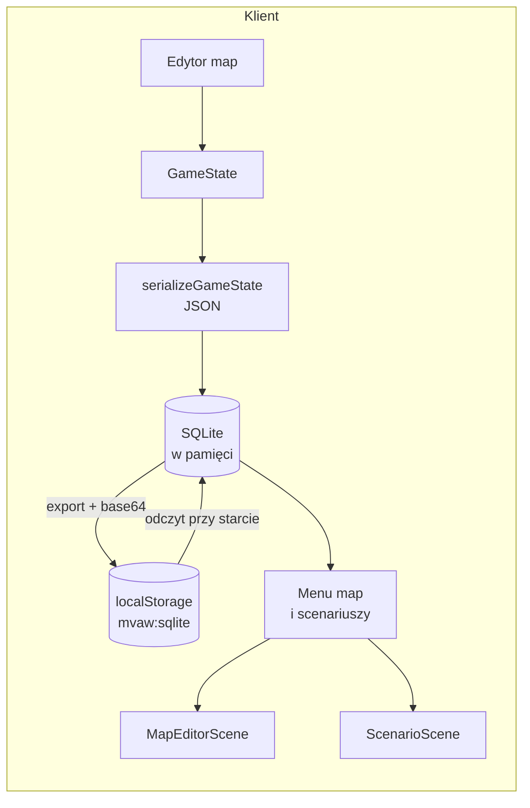

# Mapy i baza SQLite

> [!info] Co opisuje ta notatka
> Model mapy, format zapisu, schemat tabeli `maps`, seed map, trwałość
> danych w przeglądarce i Electronie oraz sposoby diagnostyki. Infrastruktura
> uruchomieniowa jest w [[Infrastruktura]], a decyzja o wyborze SQLite —
> w [[ADR#ADR-017: Wewnętrzna baza map w SQLite (sql.js)|ADR-017]].

> [!warning] To nie jest baza MySQL z backendu
> Mapy z edytora **nie trafiają do MySQL** ani do wolumenu `db_data`. MySQL
> obsługuje przyszły backend Symfony, a mapy są trzymane w kliencie: SQLite
> uruchomiony przez `sql.js` (WebAssembly) i zapisany w `localStorage` pod
> kluczem `mvaw:sqlite`.

> [!info]- Spis treści
> 1. [[#Przegląd]]
> 2. [[#Model mapy]]
> 3. [[#Schemat bazy]]
> 4. [[#Format stanu gry]]
> 5. [[#Seed przy otwarciu bazy]]
> 6. [[#Zapis i odczyt]]
> 7. [[#Trwałość i lokalizacja danych]]
> 8. [[#Identyfikatory i mapy wbudowane]]
> 9. [[#Limity i zachowanie awaryjne]]
> 10. [[#Diagnostyka i kopie zapasowe]]
> 11. [[#Testy i pliki]]
> 12. [[#Rozwiązywanie problemów]]

---

## Przegląd

Mapy w bazie pochodzą z trzech źródeł, ale wszystkie są w jednej tabeli:

- **wbudowane** — generowane w kodzie (`client/src/core/map/catalog.ts`) i
  seedowane do bazy przy jej otwarciu, jeśli nie ma jeszcze ich wpisu,
- **scenariusz `front-wschodni`** — generowany w `client/src/core/scenario.ts`
  i seedowany tak samo jak mapy wbudowane,
- **zapisane** — tworzone lub modyfikowane w edytorze i zapisywane przyciskiem
  `ZAPISZ` do lokalnej bazy SQLite.

Baza jest **lokalna dla profilu i originu**. Nie ma synchronizacji między
urządzeniami, przeglądarkami ani profilami Electrona. To świadoma decyzja z
ADR-017 — gra ma działać bez backendu.

> [!important] Mapy startowe są seedowane, ale nie nadpisują zapisów
> `seedBuiltInMaps()` w `client/src/storage/maps.ts` wstawia przy otwarciu bazy
> brakujące wpisy: `dolina` i `wzgorza` (stan z `core/map/catalog.ts`) oraz
> `front-wschodni` (stan z `core/scenario.ts`). Używa
> `INSERT ... ON CONFLICT(id) DO NOTHING`, więc zapisana wersja mapy nigdy nie
> jest nadpisywana. Tabela nie ma kolumny `source` — pochodzenie mapy wynika
> wyłącznie z jej `id`. Usunięcie wiersza sprawia, że następne otwarcie bazy
> odtworzy wersję z kodu.



Przepływ zapisu:

1. `MapEditorScene` składa `GameState` (mapa + jednostki + licznik).
2. `saveMap()` woła `openMapDatabase()`, które tworzy schemat
   (`ensureMapsSchema()`) i dosiewa brakujące mapy startowe.
3. `upsertMap()` robi `INSERT ... ON CONFLICT(id) DO UPDATE`, więc kolejny zapis
   tego samego `id` aktualizuje wpis zamiast go dublować.
4. `persistDatabase()` eksportuje całą bazę przez `db.export()`, koduje do
   base64 i zapisuje w `localStorage`.
5. Menu map i menu scenariuszy odczytują wpisy przez `listSavedMaps()` oraz
   `loadSavedMap()`.

---

## Model mapy

Mapa jest zbiorem heksów o **absolutnych współrzędnych**, a nie prostokątną
tablicą o stałym rozmiarze. Dzięki temu można malować poza pierwotnym obszarem,
a mapa rośnie w każdą stronę bez przesuwania istniejących kafli.

```ts
interface GameMap {
  readonly cells: Readonly<Record<string, TerrainId>>;
  readonly fogOfWar: boolean;
}

interface GameState {
  readonly map: GameMap;
  readonly units: readonly Unit[];
  readonly nextUnitSeq: number;
}
```

Stan tury (`TurnState` z `client/src/core/turn.ts`) nie jest częścią `GameState`.
`GameState` opisuje zapisywalną mapę i jednostki, a tura jest stanem sesji
scenariusza — dzięki temu format JSON i schemat SQLite nie muszą się zmieniać
przy każdej zmianie zasad tur (ADR-020).

- Klucz komórki to `"col,row"`, np. `"12,3"`.
- `col` i `row` są liczbami całkowitymi w układzie **offset odd-r**; wartości
  mogą być ujemne, bo mapa może rosnąć też w lewo i w górę.
- Numeracja w HUD edytora jest **podwojona** (`2 * col + (row & 1)`) — szczegóły
  w [[ADR#ADR-004: Siatka heksagonalna|ADR-004]].
- Brak wpisu w `cells` oznacza brak kafla (czarne tło), a nie domyślną łąkę.
- `fogOfWar` to flaga mapy: `false` (domyślnie) pokazuje w scenariuszu wszystkie
  jednostki, a `true` włącza mgłę wojny opartą na zasięgu wzroku
  ([[ADR#ADR-030: Mgła wojny oparta na zasięgu wzroku|ADR-030]],
  [[ADR#ADR-034: Mgła wojny z pamięcią odkrytych pól|ADR-034]]). Pamięć
  odkrytych pól jest per strona i żyje tylko w sesji scenariusza — nie ma jej
  w formacie JSON ani w schemacie SQLite.
  Operacje na kaflach (`setTerrain`, `removeTerrain`, `fillMap`, `extendMap`,
  `paintRect`) zachowują flagę; `createMap()` i `clearMap()` ustawiają `false`.

### Tereny

Reguły terenu — koszt ruchu, przechodniość i obrona — są w
[[Zalozenia#ZAL-003: Mapa i teren|ZAL-003]]. `TerrainId` to jeden z:
`plain`, `forest`, `water`, `mountain`, `swamp`, `road`, `city`.

Źródło: `client/src/core/map/terrain/` — jeden plik na teren. Lista `TERRAIN_IDS` jest jednocześnie
listą dozwolonych wartości przy odczycie z bazy — nowy teren trzeba dodać
również tam.

### Jednostki

Jednostka ma `id`, `kind`, `faction`, `pos`, `hp`, `movesLeft` i `hasActed`.
Czołg i artyleria mają zapas sześciu strzałów wyliczany z ruchu: pełny
`movesLeft` daje 6 pocisków, a każdy wydany punkt ruchu proporcjonalnie
zmniejsza zapas. Jednostka nie przechowuje pola `ammo`; starszy zapis z tym
polem jest akceptowany i ignorowany. `beginTurn()` przywraca ruch jednostkom
aktywnej strony, więc pociski wracają razem z nim. Zasięg wzroku i strzału nie
jest zapisywany w jednostce — wynika z `UnitStats` w `UNIT_DEFS` i służy do
liczenia mgły wojny oraz obrysów zasięgów w scenariuszu.

Statystyki jednostek (HP, ruch, atak, obrona, zasięgi, amunicja) są w
[[Zalozenia#ZAL-004: Jednostki|ZAL-004]]. Zasady walki opisuje
[[Zalozenia#ZAL-006: Walka|ZAL-006]], a liczy je `client/src/core/combat.ts`.

Strony: `blue`, `red`, `neutral`. W edytorze dostępne są niebieska i czerwona;
`neutral` jest obsługiwana przez model i walidację.

---

## Schemat bazy

Schemat tworzy `MAPS_SCHEMA` w `client/src/storage/maps.ts`, wywoływany przez
`ensureMapsSchema()` przy każdym otwarciu bazy. Pełny stan tabeli:

```sql
CREATE TABLE IF NOT EXISTS maps (
  id          TEXT PRIMARY KEY,
  name        TEXT NOT NULL,
  description TEXT NOT NULL DEFAULT '',
  state       TEXT NOT NULL,
  tiles       INTEGER NOT NULL,
  units       INTEGER NOT NULL,
  created_at  TEXT NOT NULL,
  updated_at  TEXT NOT NULL
);
```

| Kolumna       | Znaczenie |
| ------------- | --------- |
| `id`          | Klucz mapy. Wbudowane: `dolina`, `wzgorza`; scenariusz: `front-wschodni`; nowe: `local-<base36>` z `Date.now()`. |
| `name`        | Nazwa widoczna w menu. |
| `description` | Opis; zapis z edytora używa domyślnie „Mapa zapisana w edytorze”. |
| `state`       | Cały `GameState` jako JSON (patrz [[#Format stanu gry]]). |
| `tiles`       | Liczba kafli w `state.map.cells`; liczona przy zapisie. |
| `units`       | Liczba jednostek w `state.units`; liczona przy zapisie. |
| `created_at`  | Data pierwszego zapisu, ISO 8601 UTC. |
| `updated_at`  | Data ostatniego zapisu, ISO 8601 UTC; aktualizowana przy upsercie. |

`created_at` nie jest nadpisywane przy kolejnym zapisie tego samego `id`.
`updated_at` jest ustawiane przez `upsertMap()` na czas bieżący. Seed używa
stałej daty `2026-01-01T00:00:00.000Z`, więc mapy startowe mają wspólny
`updated_at` do pierwszego zapisu użytkownika.

Przykładowy wiersz (`state` skrócony):

```text
id         = local-mvky46yh
name       = Moja mapa
description= Mapa zapisana w edytorze
tiles      = 48
units      = 1
created_at = 2026-10-23T12:28:08.666Z
updated_at = 2026-10-23T12:28:08.666Z
state      = {"map":{"cells":{"0,0":"plain","1,0":"forest"},"fogOfWar":false},"units":[...],"nextUnitSeq":2}
```

---

## Format stanu gry

`state` to wynik `serializeGameState()` z
`client/src/storage/mapSerialization.ts`:

```json
{
  "map": {
    "cells": {
      "0,0": "plain",
      "1,0": "forest",
      "2,0": "water"
    },
    "fogOfWar": false
  },
  "units": [
    {
      "id": "u1",
      "kind": "tank",
      "faction": "blue",
      "pos": { "col": 1, "row": 0 },
      "hp": 20,
      "movesLeft": 3,
      "hasActed": false
    }
  ],
  "nextUnitSeq": 2
}
```

Przy odczycie `deserializeGameState()` odrzuca:

- tekst, który nie jest poprawnym JSON-em,
- brak `map`, `map.cells`, `units` albo `nextUnitSeq`,
- klucz komórki niezgodny z `^-?\d+,-?\d+$`,
- nieznany `TerrainId`,
- jednostkę bez `id`, z nieznanym `kind`/`faction`, bez poprawnej pozycji,
- jednostkę bez poprawnych `hp`, `movesLeft`, `hasActed`,
- `map.fogOfWar` innego typu niż `boolean`.

Brak `map.fogOfWar` w starszym zapisie jest dozwolony i oznacza `false`.

Dzięki temu uszkodzony wpis nie wywraca całego menu — odczyt pojedynczej mapy
kończy się błędem, a reszta listy może się pokazać.

---

## Seed przy otwarciu bazy

### Otwarcie bazy

`openMapDatabase()` w `client/src/storage/maps.ts` przy każdym użyciu bazy:

1. pobiera współdzieloną instancję z `openDatabase()`,
2. tworzy tabelę przez `ensureMapsSchema()` (`CREATE TABLE IF NOT EXISTS`),
3. woła `seedBuiltInMaps(db)`, która wstawia brakujące mapy startowe,
4. jeśli seed coś wstawił, od razu woła `persistDatabase(db)`.

Seed jest idempotentny: drugie otwarcie nie wstawia już tych samych `id`.
Nie ma tabeli `schema_migrations` ani pliku JSON — dane startowe są generowane
w kodzie, więc nie trzeba ich walidować przy odczycie z pliku.

### Co zawiera seed

| `id` | Źródło stanu | Jednostki |
| ---- | ------------ | --------- |
| `dolina` | `BUILT_IN_MAPS` w `client/src/core/map/catalog.ts` | 0 (uzupełniane w sesji scenariusza) |
| `wzgorza` | `BUILT_IN_MAPS` w `client/src/core/map/catalog.ts` | 0 (uzupełniane w sesji scenariusza) |
| `front-wschodni` | `BUILT_IN_SCENARIOS` w `client/src/core/scenario.ts` | po 10 na stronę |

Wstawienie korzysta z `INSERT INTO maps (...) VALUES (...) ON CONFLICT(id) DO
NOTHING`, więc istniejący wiersz — także zapisany przez użytkownika — zostaje
bez zmian.

> [!note] Brak wersjonowania schematu
> Schemat nie jest jeszcze wersjonowany. `ensureMapsSchema()` tworzy tabelę,
> jeśli jej nie ma, ale nie dodaje nowych kolumn do istniejącej bazy. Zmiana
> schematu wymaga zadania GRA-026 (runner migracji); do tego czasu trzeba
> wyczyścić `mvaw:sqlite` albo dopisać migrację ręcznie.

### Dodawanie mapy startowej

- dopisz mapę do `BUILT_IN_MAPS` (albo scenariusz do `BUILT_IN_SCENARIOS`),
- nowy `id` zostanie dosiany przy następnym otwarciu bazy,
- jeśli chcesz zmienić już seedowany wiersz, usuń go z bazy — następne
  otwarcie odtworzy stan z kodu (o ile nie zapiszesz go wcześniej z edytora).

---

## Zapis i odczyt

### Zapis z edytora

- `ZAPISZ` w `MapEditorScene` woła `saveCurrentMap()`.
- Nowa mapa dostaje `local-<base36>`; mapa wbudowana lub scenariusz zachowuje
  swoje `id` (`dolina`/`wzgorza`/`front-wschodni`), więc zapis aktualizuje
  istniejący wiersz.
- Po udanym zapisie przycisk pokazuje `ZAPISANO`; przy błędzie `BŁĄD ZAPISU`.
- Samo wyjście `ESC` **nie zapisuje do bazy**. Dla mapy, która ma już
  `mapId` (wbudowana albo wcześniej zapisana), `leaveTo()` odkłada szkic w
  `registry` na czas sesji; wraca on po powrocie z menu map, ale ginie po
  restarcie aplikacji. Nowa, jeszcze niezapisana mapa nie ma `mapId`, więc
  wyjście nie zachowuje nawet szkicu sesji.
- Zapis dotyczy całego `GameState`: terenu, jednostek i `nextUnitSeq`.

### Odczyt w menu

- Menu map pokazuje „Nowa mapa” i wszystkie mapy z SQLite na jednej liście:
  wbudowane, scenariusz `front-wschodni` i mapy zapisane w edytorze.
- Menu scenariuszy czyta tę samą listę przez `listSavedMaps()`; każda mapa jest
  potencjalnym scenariuszem (ADR-026).
- Szkic z bieżącej sesji ma pierwszeństwo przed stanem z bazy i jest oznaczony
  dopiskiem „szkic”.
- Nie ma osobnej sekcji „ZAPISANE MAPY (SQLite)” ani scalania kafelków —
  wbudowana mapa i jej zapis to jeden wiersz o tym samym `id`.

### Cykl życia bazy

`openDatabase()` trzyma jedną współdzieloną obietnicę (`databasePromise`) na
czas życia strony. Pierwsze otwarcie:

1. ładuje `sql.js` i WASM,
2. czyta `localStorage['mvaw:sqlite']`,
3. dekoduje base64 do `Uint8Array`,
4. tworzy `new SQL.Database(bytes)`,
5. tworzy schemat (`ensureMapsSchema()`) i dosiewa brakujące mapy
   (`seedBuiltInMaps()`), a jeśli coś wstawiono, od razu zapisuje bazę do
   `localStorage`. Operacje na replayach dodatkowo wywołują
   `ensureReplaysSchema()`.

Jeżeli zapisany bajtowo plik jest uszkodzony, `createDatabase()` usuwa klucz z
`localStorage` i tworzy pustą bazę. Oznacza to **utratę poprzednich map** — nie
ma automatycznego backupu. Seed odtworzy tylko mapy startowe; zapisane mapy
przepadają.

---

## Replaye i plany tur

Tabele `replays` i `turn_plans` tworzy `REPLAYS_SCHEMA` z
`client/src/storage/replays.ts`, wywoływany przez `ensureReplaysSchema()` przy
każdym otwarciu bazy:

```sql
CREATE TABLE IF NOT EXISTS replays (
  id             TEXT PRIMARY KEY,
  scenario_id    TEXT NOT NULL,
  scenario_name  TEXT NOT NULL DEFAULT '',
  player_faction TEXT NOT NULL,
  initial_state  TEXT NOT NULL,
  created_at     TEXT NOT NULL,
  updated_at     TEXT NOT NULL
);

CREATE TABLE IF NOT EXISTS turn_plans (
  replay_id   TEXT NOT NULL,
  turn        INTEGER NOT NULL,
  faction     TEXT NOT NULL,
  plan        TEXT NOT NULL,
  state_after TEXT NOT NULL,
  created_at  TEXT NOT NULL,
  PRIMARY KEY (replay_id, turn)
);
```

| Kolumna | Znaczenie |
| ------- | --------- |
| `replays.id` | `replay-<base36>` z `createReplayId()`; nowy rekord na każdy start scenariusza. |
| `replays.scenario_id` | Identyfikator scenariusza lub zapisanej mapy, z której startuje bitwa. |
| `replays.player_faction` | Strona wybrana przez gracza (`blue`/`red`). |
| `replays.initial_state` | `GameState` po `beginTurn()` pierwszej strony, JSON z `serializeGameState()`. |
| `turn_plans.plan` | Plan tury JSON z `version`, `faction`, `turn` i `units` (akcje `move`/`attack`). |
| `turn_plans.state_after` | Stan po `commitPlan()` tury, przed `beginTurn()` następnej strony. |

Start scenariusza wywołuje `startReplay()`; każda wykonana tura dopisuje plan
przez `recordTurnPlan()` i od razu utrwala bazę w `localStorage`. Para
`(replay_id, turn)` jest kluczem, więc powtórny zapis tej samej tury nadpisuje
wpis. `updated_at` replaya zmienia się przy każdym dopisanym planie.

Format planu pilnuje `client/src/storage/planSerialization.ts`:
`PLAN_FORMAT_VERSION = 1`, a `deserializeTurnPlan()` odrzuca nieznaną wersję,
złą stronę, numer tury, akcję bez trasy lub celu i współrzędne spoza liczb.
`readReplay()` czyta plany rosnąco po `turn`; pierwszy uszkodzony wiersz
przerywa odczyt i ustawia `truncated`, dzięki czemu reszta sceny działa.
Uszkodzony `initial_state` rzuca błąd, a `loadReplay()` zamienia go na
`undefined`.

Odtworzenie stanu robi `replayStates()`: dla każdego planu wywołuje
`beginTurn(state, faction)`, potem `commitPlan(state, plan)` i zwraca kolejne
stany. Ostatni stan jest równy `state_after` ostatniej tury.

`deleteReplaysForScenario()`/`removeScenarioReplays()` usuwają najpierw
`turn_plans`, potem `replays` dla danego `scenario_id`. Dziś nie ma interfejsu
usuwania scenariuszy, więc funkcja czeka na wywołanie z przyszłego menu.
Replay trzyma tylko akcje, a stan jednostek jest checkpointem — mimo to
`localStorage` rośnie z każdą turą i nie ma automatycznego przycinania historii.

---

## Trwałość i lokalizacja danych

`localStorage` jest przypisany do **originu** (schemat + host + port), a w
Electronie dodatkowo do katalogu profilu (`app.getPath('userData')`). Ten sam
kod w innym originie lub profilu widzi inną bazę.

| Środowisko | Origin | Profil / katalog danych | Widzi mapy z dev Electrona? |
| ---------- | ------ | ----------------------- | :-------------------------: |
| Przeglądarka — build nginx | `http://localhost:18080/` (strona) i `/game/` (gra — ten sam origin) | profil przeglądarki | ❌ |
| Przeglądarka — Vite | `http://localhost:18573` | profil przeglądarki | ❌ |
| Electron dev (`make electron`) | `app://bundle/index.html` | Linux: `~/.config/@my-very-advance-wars/electron` | ✅ |
| Electron z `VITE_DEV_SERVER_URL` | np. `http://localhost:19000` | ten sam profil, inny origin | ❌ |
| Electron packaged | `app://bundle/index.html` | katalog zależny od `productName` | ❌ (inny profil) |
| `http://127.0.0.1:18080/` | inny host niż `localhost` | ten sam profil przeglądarki, inny origin | ❌ |

> [!important] Zmiana portu lub hosta zmienia origin
> Po zmianie `CLIENT_PORT`, `BACKEND_PORT` (albo `VITE_DEV_SERVER_URL`) mapa
> nadal leży w starym `localStorage`, ale aplikacja czyta już inny origin i
> pokazuje pustą listę. Nie oznacza to, że baza zniknęła. Wróć na stary
> port/origin albo przenieś base64 z `mvaw:sqlite` ręcznie.

W Electronie dev dane leżą w profilu:

```text
~/.config/@my-very-advance-wars/electron/
├── Local Storage/leveldb/       # tu Chromium trzyma mvaw:sqlite
├── Session Storage/
└── ...
```

Na innych systemach jest to odpowiednik `app.getPath('userData')`. Nie edytuj
plików LevelDB ręcznie — korzystaj z DevTools albo eksportu base64.

> [!note] `make clean` nie usuwa map
> `make clean` usuwa kontenery i woluminy Compose (`db_data`,
> `client_node_modules`, `server_vendor`). Baza map jest poza Compose, więc
> **przetrwa** `make clean`, `make down` i usunięcie obrazów. Usuwa ją dopiero
> wyczyszczenie danych profilu Electrona/przeglądarki.

---

## Identyfikatory i mapy wbudowane

| `id` | Skąd | Zachowanie przy zapisie |
| ---- | ---- | ----------------------- |
| `dolina` | `BUILT_IN_MAPS` + seed | Wiersz powstaje przy otwarciu bazy; zapis aktualizuje ten sam `id`. |
| `wzgorza` | `BUILT_IN_MAPS` + seed | Jak wyżej. |
| `front-wschodni` | `BUILT_IN_SCENARIOS` + seed | Jak wyżej; startowo ma po 10 jednostek na stronę. |
| `local-<base36>` | `createSavedMapId()` | Nowy unikalny identyfikator dla „Nowej mapy”; kolejne zapisy aktualizują ten sam wiersz. |

Konsekwencje:

- seed mapy startowej nie tworzy drugiej mapy o innym `id` — to ta sama
  tożsamość widoczna w menu map i menu scenariuszy,
- zapis mapy wbudowanej lub scenariusza nie tworzy duplikatu; aktualizuje
  istniejący wiersz,
- usunięcie wiersza z bazy przywraca wersję z kodu przy następnym otwarciu
  (nie ma mechanizmu „przywróć” w UI),
- `created_at` pozostaje z pierwszego wpisu (seed ma stałą datę), `updated_at`
  zmienia się przy każdym zapisie użytkownika.

---

## Limity i zachowanie awaryjne

- **Pojemność:** `localStorage` ma zwykle około 5 MB na origin. Base64 zwiększa
  rozmiar binarnego pliku o około 1/3. Duża liczba map lub duże mapy mogą
  przekroczyć limit i zakończyć się błędem zapisu.
- **Brak transakcji między pamięcią a `localStorage`:** `upsertMap()` zmienia
  bazę w pamięci, a `persistDatabase()` dopiero potem eksportuje całość. Błąd
  `localStorage.setItem` oznacza, że zmiana zostaje tylko w pamięci do końca
  sesji.
- **Schemat bez wersjonowania:** `ensureMapsSchema()` tworzy tabelę tylko
  wtedy, gdy jej nie ma; nie dodaje kolumn do istniejącej bazy. Zmiana schematu
  wymaga migracji (GRA-026) albo wyczyszczenia `mvaw:sqlite`.
- **Seed tylko dla brakujących `id`:** `seedBuiltInMaps()` używa
  `ON CONFLICT(id) DO NOTHING`, więc nie nadpisuje istniejących map. Usunięty
  wiersz startowy wróci przy następnym otwarciu bazy.
- **Brak współdzielenia:** dwie karty/okna tego samego originu mogą mieć własne
  instancje `sql.js`; ostatni zapis wygrywa. Nie ma blokad ani merge'u.
- **Brak uwierzytelniania i szyfrowania:** dane są jawne w profilu użytkownika.
  Nie zapisuj w mapach sekretów.
- **Uszkodzona baza:** przy błędzie odczytu klucz `mvaw:sqlite` jest usuwany i
  tworzona jest pusta baza. Przed eksperymentami zrób kopię base64.

Docelowo, przy większych mapach i synchronizacji, magazyn trzeba przenieść do
IndexedDB albo backendu/API (GRA-003). Obecny mechanizm jest świadomie prosty.

---

## Diagnostyka i kopie zapasowe

### Podgląd bazy w Electronie

```bash
ELECTRON_DEVTOOLS=1 make electron
```

W konsoli DevTools:

```js
// Origin i klucz
location.origin;
localStorage.getItem('mvaw:sqlite')?.length;
```

`localStorage.getItem('mvaw:sqlite')` zwraca **base64 całego pliku SQLite**.
Możesz go skopiować do pliku:

```js
copy(localStorage.getItem('mvaw:sqlite'));
```

Następnie w terminalu (Linux/macOS):

```bash
base64 -d mapy.b64 > mapy.sqlite
sqlite3 mapy.sqlite "SELECT id, name, tiles, units, updated_at FROM maps;"
```

`sqlite3` nie jest wymagany do działania gry — to tylko narzędzie diagnostyczne.
Jeśli go nie masz, możesz odczytać bazę przez `sql.js` w konsoli lub w skrypcie
Node.

### Kopia i przywrócenie

- **Backup:** skopiuj base64 z `localStorage.getItem('mvaw:sqlite')` i zachowaj
  w bezpiecznym miejscu.
- **Przywrócenie:** w konsoli tego samego originu ustaw
  `localStorage.setItem('mvaw:sqlite', '<base64>')` i przeładuj stronę.
- **Reset:** `localStorage.removeItem('mvaw:sqlite')` i przeładuj stronę.
  To usuwa **wszystkie** zapisane mapy w tym originie/profilu.
- Po resecie lub przywróceniu baza w pamięci jest odtwarzana dopiero po
  przeładowaniu strony — `databasePromise` jest cache'owany.

### Szybka diagnoza „mapa zniknęła”

1. Sprawdź, czy przed zamknięciem kliknięto `ZAPISZ` i pojawiło się
   `ZAPISANO`; `ESC` nie zapisuje.
2. Sprawdź `location.origin` — czy to ten sam host i port co wcześniej.
3. Sprawdź, czy to ten sam profil Electrona (`app.getPath('userData')`), a nie
   przeglądarka, Vite albo inna paczka desktopowa.
4. Sprawdź, czy nie patrzysz na szkic z sesji (dopisek „szkic”) zamiast stanu
   z bazy; szkic ginie po restarcie strony.
5. Zobacz `localStorage.getItem('mvaw:sqlite')?.length` — `0`/`null` oznacza
   brak bazy w tym originie.

---

## Testy i pliki

| Plik | Rola |
| ---- | ---- |
| `client/src/integrations/sqlite/database.ts` | `sql.js`, WASM, odczyt/zapis `localStorage`, base64. |
| `client/src/storage/maps.ts` | `MAPS_SCHEMA`, `ensureMapsSchema`, `seedBuiltInMaps`, `upsertMap`, `listMaps`, `readMap`, `saveMap`, `listSavedMaps`, `loadSavedMap`, `createSavedMapId`. |
| `client/src/storage/mapSerialization.ts` | serializacja i walidacja `GameState`. |
| `client/src/storage/planSerialization.ts` | `PLAN_FORMAT_VERSION`, serializacja i walidacja planu tury. |
| `client/src/storage/replays.ts` | `REPLAYS_SCHEMA`, `ensureReplaysSchema`, `createReplay`, `appendTurnPlan`, `listReplays`, `readReplay`, `replayStates`, `deleteReplaysForScenario`, `startReplay`, `recordTurnPlan`, `loadReplay`. |
| `client/src/core/map/model.ts` | model `GameMap`, klucze komórek, liczniki, granice. |
| `client/src/core/map/movement.ts` | symulacja ruchu jednostek: `findUnitAt`, koszt terenu, trasa, zasięg i wykonanie ruchu. |
| `client/src/core/state.ts` | `GameState`, jednostki, `nextUnitSeq`. |
| `client/src/core/map/terrain/` | definicje terenu: `TerrainId`, `TerrainDef`, `TERRAIN_DEFS`, `TERRAIN_IDS`, `pickVariantIndex`; jeden plik na teren. |
| `client/src/core/units/` | model `Unit`, `UNIT_DEFS` i `createUnit`; strony w `faction.ts`, osobny plik na każdy rodzaj jednostki. |
| `client/tests/storage/maps.test.ts` | schemat, zapis, upsert, odczyt, ID i jednorazowy seed map startowych. |
| `client/tests/storage/mapSerialization.test.ts` | round-trip i odrzucanie uszkodzonych danych. |
| `client/tests/storage/planSerialization.test.ts` | round-trip planu, wersja formatu i odrzucanie uszkodzonych akcji. |
| `client/tests/storage/replays.test.ts` | zapis replaya, odtwarzanie stanu, uszkodzone wpisy i sprzątanie po scenariuszu. |

Uruchamianie:

```bash
make test                 # cd client && npm test
make lint                 # cd client && npx tsc --noEmit
cd client && npm run build
```

Testy `storage/` używają prawdziwego `sql.js` w pamięci, bez `localStorage`.

---

## Rozwiązywanie problemów

> [!question]- Po restarcie Electrona nie ma zapisanej mapy
> Najpierw sprawdź, czy kliknięto `ZAPISZ` (a nie tylko `ESC`). Następnie
> sprawdź origin i profil — mapa jest widoczna tylko tam, gdzie została
> zapisana. Mapy wbudowane i `front-wschodni` są seedowane, więc po pustej
> bazie pojawią się ponownie, ale zapisane mapy użytkownika nie.

> [!question]- Zmieniłem `CLIENT_PORT` i mapy zniknęły
> Zmienił się origin (`http://localhost:<port>`), więc przeglądarka/Electron
> czyta inny `localStorage`. Wróć na poprzedni port albo przenieś base64
> `mvaw:sqlite` ręcznie.

> [!question]- Widzę mapę, ale bez ostatnich zmian
> `ESC`/wyjście z edytora zapisuje tylko szkic w `registry` na czas sesji.
> Trwały zapis robi wyłącznie `ZAPISZ`. Po restarcie wraca ostatni stan z bazy.

> [!question]- Baza się uszkodziła / menu nie pokazuje map
> Sprawdź konsolę (`Nie udało się odczytać map z SQLite`). Uszkodzony plik jest
> odrzucany i zastępowany pustą bazą. Jeśli masz kopię base64, przywróć ją i
> przeładuj stronę. Bez kopii dane są tracone.

> [!question]- Dodałem mapę do katalogu, ale jej nie widzę
> Seed działa przy każdym otwarciu bazy i wstawia tylko brakujące `id`.
> Sprawdź, czy nowa mapa jest w `BUILT_IN_MAPS` (albo scenariusz w
> `BUILT_IN_SCENARIOS`), przeładuj stronę i upewnij się, że w bazie nie ma już
> wiersza z tym samym `id` — seed go nie nadpisze.

> [!question]- Czy mapy są w MySQL/Adminerze?
> Nie. MySQL i Adminer dotyczą backendu Symfony. Mapy z edytora są wyłącznie w
> SQLite w `localStorage` klienta.

---

> [!success] Powiązane
> - [[Infrastruktura]] — porty, Compose, Electron i profile.
> - [[Interfejs#INTERF-006: Wewnętrzna baza map (SQLite)|INTERF-006]] — kontrakt UI.
> - [[ADR#ADR-017: Wewnętrzna baza map w SQLite (sql.js)|ADR-017]] — decyzja o SQLite.
> - [[ADR#ADR-019: Seed map przy otwarciu bazy|ADR-019]] — decyzja o seedzie map.
> - [[ADR#ADR-026: Scenariusz = mapa z SQLite|ADR-026]] — decyzja o relacji scenariusz–mapa.
> - [[Zadania-opisy#GRA-021: Zapis map w wewnętrznym SQLite|GRA-021]] — zapis map.
> - [[Zadania-opisy#GRA-026: Wersjonowane migracje SQLite|GRA-026]] — przyszłe migracje schematu.
> - [[Zadania-opisy#GRA-029: Menu scenariuszy z podglądem i edycją mapy|GRA-029]] — menu scenariuszy i edycja mapy.
